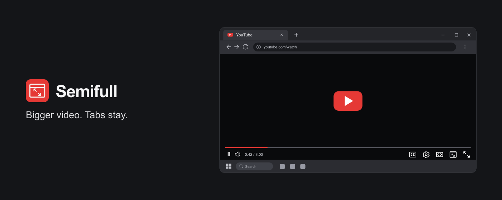

# Semifull

Expand YouTube to fill your browser tab while keeping your tabs, address bar, and taskbar visible.

Semifull adds one button immediately to the left of YouTube's fullscreen control. Click it or press **G** to switch between the expanded player and the normal page.

## Features

- Full-window viewing without entering native fullscreen.
- One player button, with no extra menus or settings.
- **G** to toggle and **Esc** to exit.
- YouTube's playback controls, captions, and settings remain available.
- Video proportions are preserved, and your page position is restored when you exit.

## Installation

Install Semifull locally in Chrome or Edge:

1. On this GitHub repository, select **Code → Download ZIP**, then extract the ZIP. You can also clone the repository.
2. Open `chrome://extensions` in Chrome or `edge://extensions` in Edge.
3. Enable **Developer mode**.
4. Click **Load unpacked** and select the extracted folder containing `manifest.json`.
5. Open or refresh a YouTube video.

Keep the extension folder in a permanent location; the browser loads its files from that folder.

## Controls

| Control | Action |
| --- | --- |
| **G** | Enter or exit Semifull |
| **Esc** | Exit Semifull |
| **Window icon left of fullscreen** | Enter or exit Semifull |

The G shortcut is ignored while typing in text fields. YouTube's existing fullscreen button and **F** shortcut remain available.

Maximize your browser for the largest viewing area. Turn off taskbar auto-hide if you want the taskbar to stay visible.

## Compatibility

Supports desktop YouTube watch pages and live streams in Chrome and Edge. Shorts and embedded players are not supported.

YouTube may change its player interface, which can require extension updates.

## Privacy

Semifull runs only on `www.youtube.com`. It does not collect or transmit user data, use analytics, or load remote code. No account is required.

See [the privacy policy](PRIVACY.md) for details.

## Updating and development

No dependencies or build step are required. The extension uses plain JavaScript, CSS, and Manifest V3.

After downloading an update or editing the files, click **Reload** on Semifull's card in the extensions page, then refresh YouTube. Locally installed extensions do not update automatically.

Semifull is an independent project and is not affiliated with YouTube or Google.

